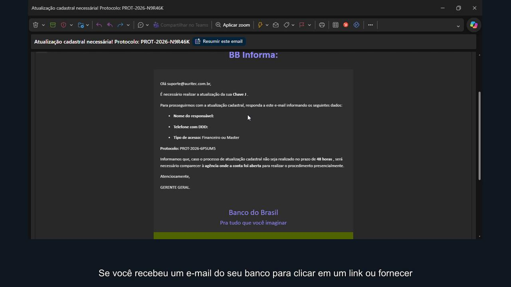

# Phishing — videoaula

Videoaula em português sobre identificação de phishing, com uma gravação de tela, a fala de um colaborador e o aviso de um narrador. Projeto preparado em 21/10/2026.

## Resultado aprovado

- [Vídeo final — MP4](exports/Phishing%20-%20video%20aula.mp4)
- [Legendas — SRT](exports/Phishing%20-%20legendas.srt)
- Duração: aproximadamente **2min24s**.
- Resolução: **1280 × 720**, 25 quadros por segundo.
- Vídeo H.264, áudio AAC; legendas incorporadas e também disponíveis em arquivo separado.



## Conteúdo

```text
media/          Gravação de tela e os dois áudios originais
transcripts/    Marcações de tempo das palavras, usadas para sincronização
exports/        Vídeo aprovado e legendas
scripts/        Renderização reproduzível
docs/           Prévia e notas de edição
roteiro.txt     Texto revisado das legendas (uma linha para cada voz)
requirements.txt
manifest.json   Tamanho e SHA-256 dos arquivos de produção
```

## Como gerar novamente

Requer Python 3.12. Execute os comandos na pasta do projeto:

```powershell
python -m venv .venv
.venv\Scripts\python.exe -m pip install -r requirements.txt
.venv\Scripts\python.exe scripts/render.py --output-dir exports/nova-versao
```

O pacote `imageio-ffmpeg` fornece o FFmpeg. A edição usa o filtro `ass` para as legendas e a fonte Arial; mudanças na versão do FFmpeg ou nas fontes disponíveis podem alterar o resultado visual. A exportação validada foi realizada no Windows.

O resultado aprovado em `exports/` é preservado por padrão. Para substituir os arquivos de um destino de forma intencional, use `--overwrite`. Não execute duas renderizações ao mesmo tempo na mesma pasta de projeto, pois elas compartilham `build/`.

As marcações de tempo já estão incluídas; não é necessário baixar um modelo de transcrição. Correções pequenas no roteiro podem reutilizar essas marcações. Ao trocar os áudios ou mudar significativamente as falas, atualize também as transcrições e os tempos definidos em `scripts/render.py`.

## Localização no repositório

Este projeto integra `SrElizeuSantos08/Academia_do_Cados`, na pasta `cursos/phishing-video-aula`.

Os vídeos e áudios originais estão em `media/`; a versão final está em `exports/`. Para executar os comandos de geração acima, entre primeiro nesta pasta.

A inclusão no GitHub disponibiliza os arquivos do projeto. O cadastro da aula no catálogo e o envio para o armazenamento da plataforma são etapas separadas, não executadas por este commit.

## Uso do material

Não foi definida uma licença de redistribuição. Confirme os direitos sobre a gravação, as vozes e as informações visíveis antes de distribuir publicamente.
